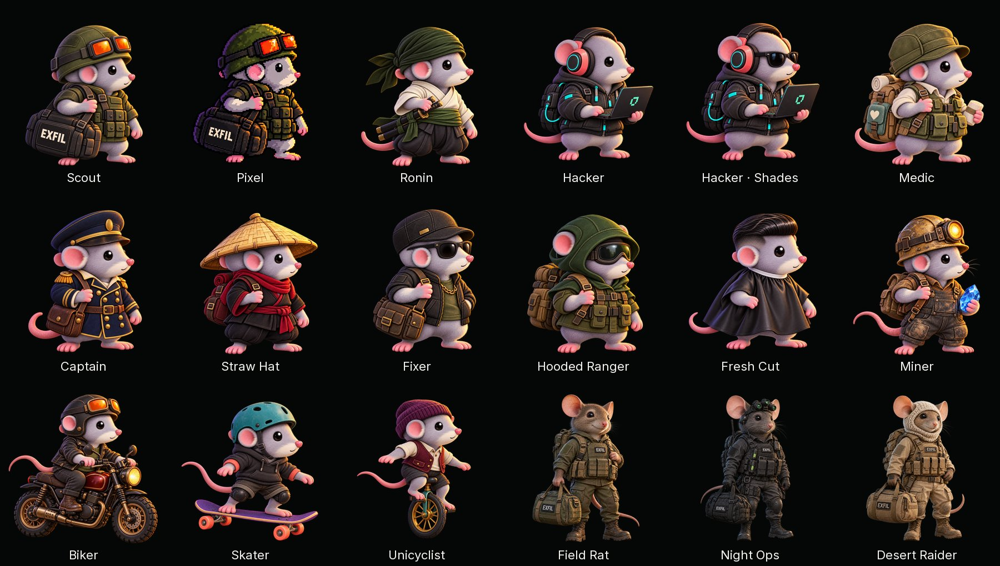

# Exfil content kit

Rats, scenes, sounds and music from [Exfil](https://exfil.fun), free for
your posts, memes, videos, streams and fan art. Read [LICENSE.md](LICENSE.md)
(the short version: make anything, monetize your content, don't sell the
art itself, don't pose as official Exfil, no tokens) and
[BRAND.md](BRAND.md) for who the rats are and what their looks mean.



## What's inside

| Folder | What |
| --- | --- |
| `rats/full-body/` | 18 full-body rats, transparent PNG, 1254 px: the Scout (`cute`), Pixel, the 13 Crew outfits and 3 Operators |
| `rats/layers/` | the dress-up layers the app and exfil.fun/rat use: bases, fur tints, kits, hats, gold crowns, with `manifest.json` for where each sits |
| `rats/scout/` | the Scout in its signs: pinkie, sleeper, and wardrobe pieces |
| `rats/characters/` | Dev rat, rekt rat, payday Scout, seller on the mine cart |
| `rats/sheets/` | multi-rat sheets: builds, looks, signs, outcomes, accessories |
| `rats/stickers/` | sticker sheets for cutting out |
| `rats/portraits/` | 12 realistic rat portraits (balaclava, beret, king…) |
| `rats/svg/` | vector traces of the Scout, pinkie, sleeper, Dev and Operators |
| `scenes/` | the trench at sunset, the hill at night, the realistic Scout |
| `video/` | looping hill, dive and deep-water clips, wide and phone (`-m`) |
| `brand/` | EXFIL banners and token art (refer-to-Exfil use only) |
| `sounds/` | the app's trade cues: buy, sell, drop, extract, whale, error… |
| `music/` | the Caper and Hideout loops |
| `prompts/` | the image prompts behind the rats, for matching the style |
| `tools/` | `compose_rat.py`, which dresses a rat from the layers |

Every file and its size is in [CATALOG.md](CATALOG.md).

## Dress a rat

```bash
pip install pillow
python3 tools/compose_rat.py --list
python3 tools/compose_rat.py cute tint-gold kit-night hat-crown -o gold-king.png
```

Layers stack on one shared canvas in the order you give them. Tints, kits
and hats fit the `cute` and `pixel` rats; every rat has a `crown-gold`.

## Tips

- The rats face right. Flip them for a rat walking left.
- PNGs are transparent; drop them straight onto footage or a background.
- `sounds/buy.wav` is mixed quiet in the app; turn it up for video.
- Tag [@exfildotfun](https://x.com/exfildotfun) and we may repost you.

Something missing? Open an issue.
